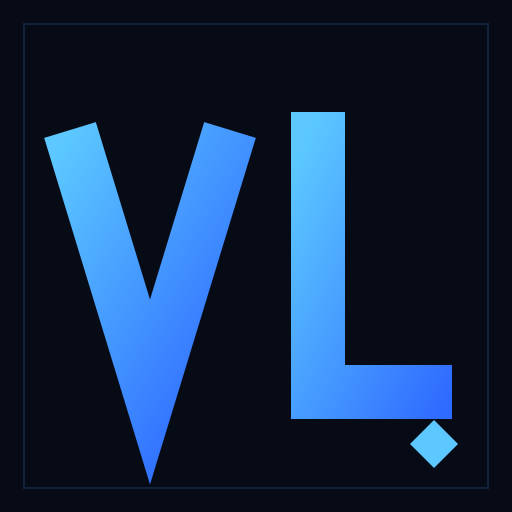
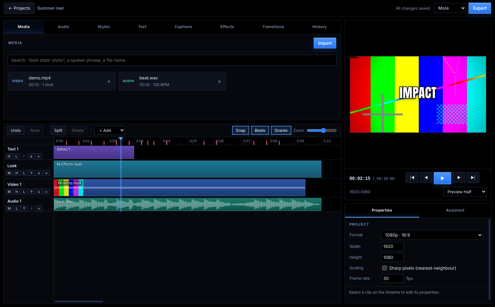

<p align="center"></p>

# VLcut

A free, local-first desktop video editor with a built-in editing assistant.
No account, no subscription, no API keys, no cloud, no watermark. Licensed GPL-3.0-or-later.



## Download (Windows)

**[Download the installer](https://github.com/twqilla/vlcut/releases/tag/latest)**: get `VLcut-Setup-0.1.0.exe` from the Releases page and run it.
Windows may say "Windows protected your PC" because the installer is not signed with a paid certificate: choose **More info**, then **Run anyway**.
Everything you need is included. Your projects and files stay on your computer; nothing is uploaded and there is no account.
Found a problem? Open an issue and paste the text from Settings → Help → Copy diagnostics (it contains no personal information).

## What it does

- **Edit by hand**: multi-track timeline, cut / split / trim / move, snapping, undo history, keyframes
  (with a custom Bézier curve editor), speed ramps and freeze frames, crop and transform.
- **Effects**: 72 stackable picture effects (blur, distortion, light, colour, texture, compositing, camera),
  20 effect stacks, 48 transitions (14 of them clean motion-blur and beat transitions with adjustable start and end ease), blend modes, track mattes, chroma / luma key, shadows, strokes,
  corner pin, `.cube` LUT import and export, video scopes, rotoscoping with draggable mask corners.
- **Text**: 74 open-licence fonts by category, gradient / metal / chrome / gold / picture fills,
  hollow, glow, 3D extrusion, distortion, vertical text and 27 text animations with exit animations.
- **Camera and motion**: stabilise, track a point and attach clips to it, auto reframe, Ken Burns,
  handheld, dolly zoom, 3D camera, hyperlapse. These run on the footage itself (block matching), no AI.
- **Sound**: 12 sound effects (EQ, reverb, echo, compressor, pitch, voice changer, vocal isolate…) that
  play live and export identically, text-to-speech with your system's voices, and an audio visualiser.
- **Settings**: change colours, corner rounding, font, text size, spacing and where the panels sit;
  eight built-in themes (including light and high contrast); share themes as files.
- **Edit by asking**: type "remove the pauses", "make it cinematic", "add a neon title saying …", "slow
  motion", "stabilise this", "make the voice a robot", "make a TikTok edit". About 45 tools, 12 whole-edit
  recipes and 90 one-click presets. The assistant plans the edit, performs it on the timeline, shows each
  step, and lets you undo steps one by one. A restore point is saved before every request.
- **Styles**: ten complete looks (grade, camera movement, transitions, typography, captions, sound
  effects, pacing). Everything a style adds is ordinary timeline content you can adjust and save as your own.
- **Captions**: offline speech recognition (whisper.cpp), word-timed animated captions in ten designs,
  manual correction, `.srt` import, `.srt` / `.vtt` export.
- **Understands footage locally**: shot detection, silence, beats and tempo, motion, brightness,
  colour, duplicate takes, shot rating, plain-language search.
- **Motion blur** by [interpolini](https://github.com/Z1xus/interpolini) (RIFE / SVP interpolation on the graphics card, weighted blend), downloaded on request.
- **Export**: H.264 / H.265, MP4 / MOV, 720p to 4K or custom size, any aspect ratio, frame rate,
  quality or bitrate, loudness normalisation.

See [docs/DEVLOG.md](docs/DEVLOG.md) for exactly what is verified and what is not yet built.

## Install (Windows)

Every push to `main` builds an installer with GitHub Actions: open the repository's **Actions** tab,
pick the latest **Build Windows installer** run and download the `VLcut-Windows-Installer` artifact.
FFmpeg is bundled. The installer is not code-signed yet, so Windows SmartScreen will ask for
confirmation; the build signs itself once a certificate is added (see [docs/SIGNING.md](docs/SIGNING.md)).

## Develop

Requires Node 22+ and FFmpeg (`ffmpeg`, `ffprobe`) on your PATH.

```bash
npm install
npm run dev        # run with hot reload
npm test           # unit and integration tests (use real FFmpeg)
npm run build      # production build into out/
npm run e2e        # drives the built app end to end (needs Playwright; on Linux run under xvfb-run)
npm run dist       # build an installer for the current platform into release/
```

## Keyboard

Space play/pause · ←/→ one frame (Shift: ten) · Home/End · S split · Del delete · Ctrl+Z / Ctrl+Shift+Z ·
Ctrl+C / V / D · Ctrl+A · +/− zoom (or Ctrl+wheel) · Ctrl+S save.

## Legal

- **Licence:** GNU General Public License v3 or later (`LICENSE`, `NOTICE`). The program comes with no warranty.
- **Third-party software and fonts:** `THIRD_PARTY_NOTICES.md` lists everything the app ships with or downloads and under which licence
  (FFmpeg GPL build, Electron, whisper.cpp, interpolini, 73 open fonts). The installer carries the licence texts in its `legal` folder, and
  Settings → About shows them.
- **Source code:** every build also publishes `VLcut-source.zip` (the GPL asks that the source goes with the program).
- **Privacy:** `docs/PRIVACY.md`. Nothing is collected; a few optional downloads use the internet.
- **Your content:** you are responsible for the rights to the videos, photos, music, voices and fonts you use, and for the rules of the sites you post to.
  The app contains and downloads no copyrighted music. Regenerate the notices with `node scripts/gen-notices.mjs` after changing dependencies.
- **Names:** VLcut is an independent project. It is not related to VLC or VideoLAN, and film-style look names in the app are generic descriptions, not products of the companies that make film.
